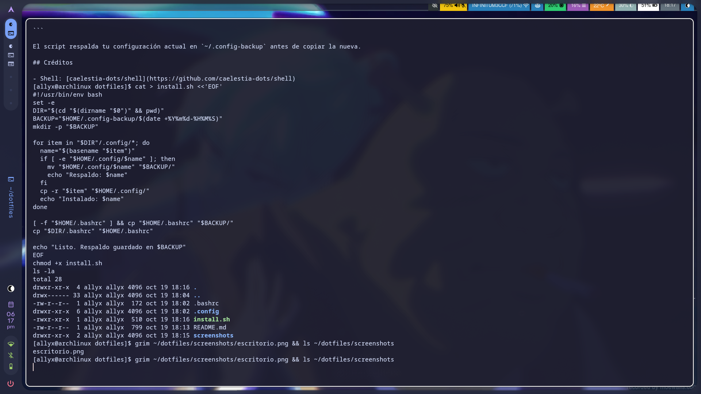

# dotfiles

Mi configuración de **Arch Linux + Hyprland**, usando [Caelestia](https://github.com/caelestia-dots/shell) como shell.



## Qué incluye

| Programa | Para qué |
|----------|----------|
| Hyprland | Compositor / gestor de ventanas |
| hyprlock / hypridle | Bloqueo de pantalla y suspensión |
| hyprpaper | Fondo de pantalla |
| Caelestia (Quickshell) | Barra, widgets y launcher |
| kitty | Terminal |
| fastfetch | Info del sistema en la terminal |

## Instalación

```bash
git clone https://github.com/asaavedra-dev/dotfiles.git
cd dotfiles
./install.sh
```

El script respalda tu configuración actual en `~/.config-backup` antes de copiar la nueva.

## Créditos

- Shell: [caelestia-dots/shell](https://github.com/caelestia-dots/shell)
